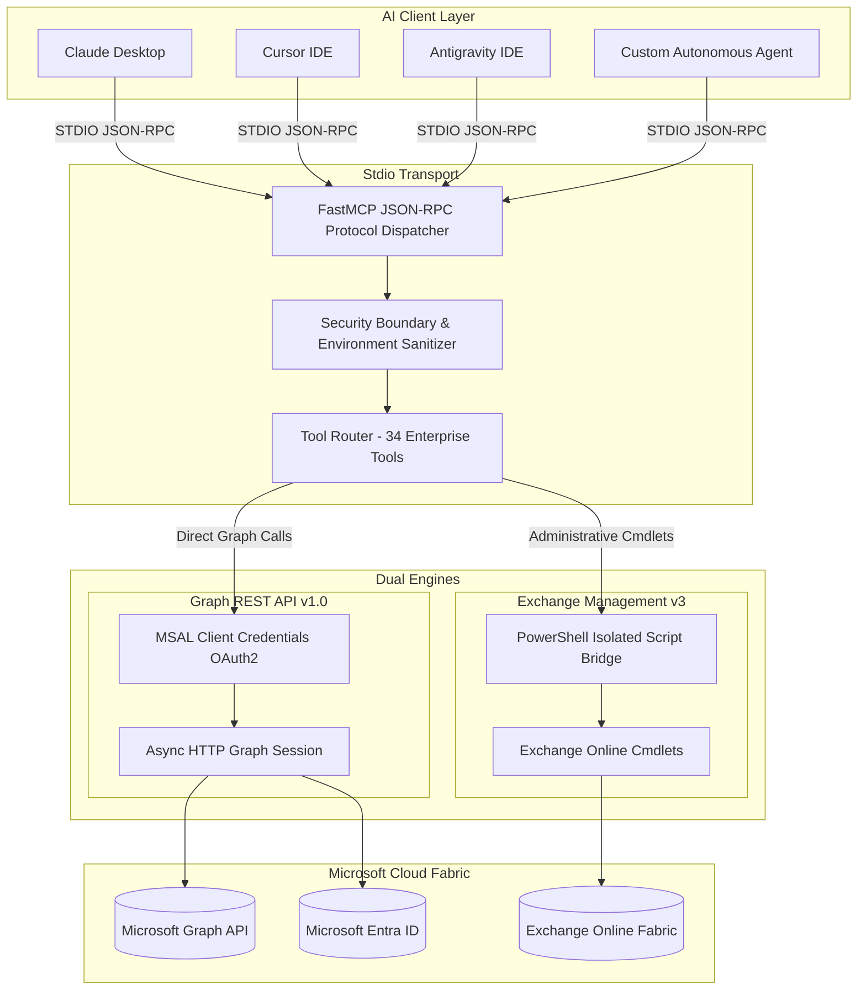

<div align="center">

# ⚡ Enterprise Microsoft 365 MCP Server

**The definitive Model Context Protocol (MCP) server for enterprise Microsoft 365, Exchange Online, Entra ID, and Microsoft Graph administration.**

[](https://opensource.org/licenses/MIT)
[](https://python.org)
[-blueviolet.svg?style=for-the-badge)](https://modelcontextprotocol.io)
[](https://learn.microsoft.com/en-us/graph/)
[](https://learn.microsoft.com/en-us/powershell/exchange/)
[](docs/ARCHITECTURE.md)

<p align="center">
  <a href="#-key-capabilities">Key Capabilities</a> •
  <a href="#-architecture">Architecture</a> •
  <a href="#-quickstart">Quickstart</a> •
  <a href="#-tool-catalog-33-tools">Tool Catalog</a> •
  <a href="#-client-configuration">Client Setup</a> •
  <a href="#-security--compliance">Security</a> •
  <a href="#-license">License</a>
</p>

</div>

---

## 🌟 Overview

The **Enterprise Microsoft 365 MCP Server** connects Large Language Models (LLMs) and AI agents (such as **Claude Desktop**, **Cursor**, **Antigravity IDE**, **Cline**, and **GitHub Copilot**) directly to enterprise Microsoft 365 environments.

Equipped with **34 enterprise-grade tools**, it bridges **Microsoft Graph REST API** (for lightning-fast directory and messaging operations) with **Exchange Online Management v3** (for deep administrative transport rules, litigation holds, quarantine management, and mail flow forensics).

---

## 🚀 Key Capabilities

```
┌─────────────────────────────────────────────────────────────────────────────┐
│                            ENTERPRISE CAPABILITIES                         │
├──────────────────────────────┬──────────────────────────────┬───────────────┤
│ 📅 Vacation & OOF Automation │ 🛡️ EOP Quarantine & Defender │ 👥 Entra ID   │
│ • Scheduled HTML auto-replies│ • Query quarantined emails   │ • GAL Search  │
│ • Temporal redirect rules    │ • Tenant Allow/Block Lists   │ • Org Sync    │
├──────────────────────────────┼──────────────────────────────┼───────────────┤
│ 📬 Mailbox & Delegation Ops  │ ⚖️ Compliance & Governance   │ 📊 Analytics  │
│ • SharedMailbox conversion   │ • Legal & Litigation Holds   │ • License SKUs│
│ • FullAccess & SendAs rights │ • Retention policies & tags  │ • Daily Digest│
├──────────────────────────────┼──────────────────────────────┼───────────────┤
│ ⚡ Microsoft Graph Engine    │ 🔍 Forensics & Mail Flow     │ 🔀 Transport  │
│ • High-speed HTML email send │ • Message delivery traces    │ • Tenant rules│
│ • Teams Adaptive Cards       │ • DKIM status & connectors   │ • Inbox rules │
└──────────────────────────────┴──────────────────────────────┴───────────────┘
```

---

## 🏗️ Architecture

The server employs a **Dual-Engine Architecture** balancing high throughput with deep administrative capability:



For complete details on thread safety, token lifecycle, and error budgets, see the [Architecture Blueprint](docs/ARCHITECTURE.md).

---

## 🛠️ Tool Catalog (34 Tools)

| Category | Tool Identifier | Engine | Purpose |
|---|---|---|---|
| **Out of Office** | `m365_get_vacation_status` | Exchange | Inspect active auto-reply window and redirect rules |
| | `m365_configure_vacation` | Exchange | Schedule HTML auto-reply + temporal team forwarding rule |
| | `m365_disable_vacation` | Exchange | Instantly deactivate OOF and clear vacation rules |
| **Offboarding** | `m365_audit_ex_employees` | Exchange | Audit disabled accounts to avoid NDR 550 5.1.10 errors |
| | `m365_convert_ex_employee_to_shared` | Exchange | Convert to free SharedMailbox, set forward with copy & hide |
| **Mailbox Ops** | `m365_get_mailbox_info` | Exchange | Retrieve quota, protocols, UPN, and forwarding config |
| | `m365_list_mailboxes` | Exchange | Filter mailboxes by type (Shared, User, Room) |
| | `m365_configure_shared_mailbox` | Exchange | Configure FullAccess, SendAs, and sent items retention |
| **Rules & Flow** | `m365_list_inbox_rules` | Exchange | List client-side and server-side rules on a mailbox |
| | `m365_list_transport_rules` | Exchange | Inspect tenant-wide mail flow and transport rules |
| | `m365_remove_inbox_rule` | Exchange | Delete a specific inbox rule by name |
| **Graph API** | `graph_send_email` | Graph API | Send corporate HTML emails with zero client latency |
| | `graph_list_recent_messages` | Graph API | Retrieve recent mailbox messages and read status |
| | `graph_send_teams_notification` | HTTP / Webhook | Broadcast rich formatted cards to Microsoft Teams |
| **Directory (GAL)** | `gal_search_directory_users` | Graph API | Search Entra ID users by name, email, or department |
| | `gal_audit_external_mail_contacts` | Exchange | Audit external MailContacts filtered by domain |
| **Compliance** | `compliance_audit_domain_signatures`| Exchange | Audit tenant disclaimer and HTML signature rules |
| | `compliance_audit_retention_policies`| Exchange | Audit retention policies and MRM tags (GDPR/LGPD) |
| | `compliance_audit_litigation_hold` | Exchange | Audit mailboxes with Litigation/Retention Hold active |
| | `compliance_audit_recoverable_items`| Exchange | Audit Recoverable Items quota & folder size hygiene |
| **Diagnostics** | `m365_message_trace` | Exchange | Trace message delivery events, failures, and routing hops |
| | `m365_verify_dkim_status` | Exchange | Verify cryptographic DKIM signing keys and status |
| | `m365_list_connectors` | Exchange | List inbound and outbound email connectors |
| **Defender & EOP** | `m365_check_quarantine` | Exchange | Query quarantined messages in Microsoft Defender |
| | `m365_list_tenant_allow_list` | Exchange | List allowed senders, domains, and URLs |
| | `m365_add_sender_to_allow_list` | Exchange | Whitelist partner domains or senders with expiration |
| **Distribution** | `m365_list_distribution_groups` | Exchange | List distribution lists and external delivery policies |
| | `m365_get_group_members` | Exchange | Enumerate distribution group members |
| | `m365_manage_group_member` | Exchange | Add or remove members from distribution groups |
| | `m365_set_group_external_delivery` | Exchange | Control unauthenticated external email permissions |
| **Licensing** | `m365_list_license_skus` | Graph API | Query tenant SKUs, consumed seats, and free licenses |
| **Profile Sync** | `m365_get_user_profile` | Graph API | Fetch department, title, phone, manager, and office |
| | `m365_update_user_profile` | Graph API | Update organizational attributes in Entra ID |
| **Intelligence** | `graph_generate_daily_activity_summary`| Graph API | Categorize recent messages into Urgent, Support, Financial |

Detailed parameter schemas and return types are documented in the [Tools Reference Manual](docs/TOOLS_REFERENCE.md).

---

## ⚡ Quickstart

### Prerequisites
- **Python 3.10+**
- **Windows PowerShell 5.1** or **PowerShell 7+** with the `ExchangeOnlineManagement` module:
  ```powershell
  Install-Module -Name ExchangeOnlineManagement -Scope CurrentUser -Force
  ```
- An **Azure Entra ID App Registration** (Follow the [Entra ID Setup Guide](docs/AZURE_ENTRA_ID_SETUP.md)).

### 1. Clone & Install
```bash
git clone https://github.com/ManoAlee/MCP-M365-MICROSOFT.git
cd MCP-M365-MICROSOFT

# Create virtual environment
python -m venv .venv
# On Windows:
.venv\Scripts\activate
# On Linux/macOS:
source .venv/bin/activate

# Install dependencies
pip install -e .
```

### 2. Configure Environment
Copy the example environment file:
```bash
cp .env.example .env
```

Edit `.env` with your Azure Entra ID credentials:
```ini
M365_TENANT_ID=00000000-0000-0000-0000-000000000000
M365_CLIENT_ID=11111111-1111-1111-1111-111111111111
M365_CLIENT_SECRET=your_client_secret_here
M365_PRIMARY_ADMIN=admin@yourtenant.onmicrosoft.com
MCP_LOG_LEVEL=INFO
```

### 3. Run Self-Tests
```bash
python -m unittest discover tests
```

---

## 💻 Client Configuration

Add this server to your preferred MCP client configuration:

### 🔷 Claude Desktop
Edit `%APPDATA%\Claude\claude_desktop_config.json` (Windows) or `~/Library/Application Support/Claude/claude_desktop_config.json` (macOS):

```json
{
  "mcpServers": {
    "m365-microsoft": {
      "command": "python",
      "args": ["-m", "mcp_m365"],
      "cwd": "C:\\path\\to\\MCP-M365-MICROSOFT",
      "env": {
        "M365_TENANT_ID": "your-tenant-id",
        "M365_CLIENT_ID": "your-client-id",
        "M365_CLIENT_SECRET": "your-client-secret",
        "M365_PRIMARY_ADMIN": "admin@yourdomain.com"
      }
    }
  }
}
```

### ⚡ Cursor IDE
Add to `.cursor/mcp.json` or Global Cursor Settings:

```json
{
  "mcpServers": {
    "m365-microsoft": {
      "command": "python",
      "args": ["-m", "mcp_m365"],
      "cwd": "/path/to/MCP-M365-MICROSOFT"
    }
  }
}
```

### 🪐 Antigravity IDE / Cline
Add to `~/.gemini/config/mcp_config.json`:

```json
{
  "mcpServers": {
    "m365-governance": {
      "command": "python",
      "args": ["-m", "mcp_m365"],
      "cwd": "C:\\path\\to\\MCP-M365-MICROSOFT"
    }
  }
}
```

---

## 🔒 Security & Compliance

This repository enforces strict enterprise security practices:

- **Zero Hardcoded Secrets:** No tenant IDs, credentials, or client secrets are committed. Everything is dynamically populated through environment variables or local ignored files.
- **Strict `.gitignore`:** Excludes `config.json`, `.env`, `*.log`, `__pycache__`, and temporary test tokens.
- **Principle of Least Privilege:** Read-only operations are favored where possible, and administrative PowerShell cmdlets require authorized service accounts.
- **Full Traceability:** Every tool invocation logs execution time and outcome for auditability.

---

## 🤝 Contributing

Contributions are welcome! Please check out [CONTRIBUTING.md](CONTRIBUTING.md) and adhere to the project's code style and security guardrails.

1. Fork the Project
2. Create your Feature Branch (`git checkout -b feature/AmazingFeature`)
3. Commit your Changes (`git commit -m 'feat: Add new M365 compliance tool'`)
4. Push to the Branch (`git push origin feature/AmazingFeature`)
5. Open a Pull Request

---

## 📄 License

Distributed under the **MIT License**. See [`LICENSE`](LICENSE) for more information.

<div align="center">
  <sub>Built with ❤️ for enterprise cloud administrators and AI engineers.</sub>
</div>
