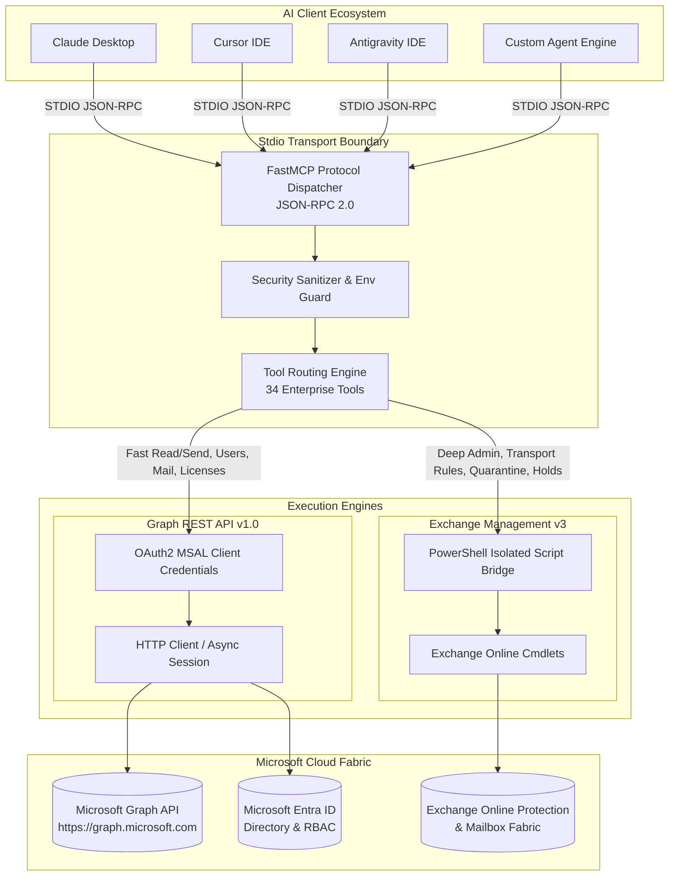

# MCP M365 Governance Server - Architectural Blueprint

This document outlines the architectural design, security boundaries, and operational layers of the **Enterprise Microsoft 365 Model Context Protocol (MCP) Server**.

---

## 1. System Overview

The **M365 Governance MCP Server** provides modern AI systems (Anthropic Claude, Cursor, Antigravity IDE, Cline, GitHub Copilot) with native tool integration for managing, automating, and auditing Microsoft 365 enterprise tenants.

---

## 2. Core Subsystems

### 2.1 Dual-Engine Execution Pipeline

1. **Microsoft Graph API Engine (High Throughput / Low Latency)**
   - Used for email dispatch (`/sendMail`), mailbox reading (`/messages`), directory searches (`/users`), license SKU inventory (`/subscribedSkus`), and profile updates.
   - Authenticates using **OAuth 2.0 Client Credentials Grant** (`client_credentials`) via Azure Entra ID App Registration.
   - Employs automatic token caching and transparent renewal upon expiration.

2. **Exchange Online PowerShell Bridge (Deep Governance)**
   - Used for complex Exchange administration cmdlets not fully surfaced via Graph API (e.g., `Get-TransportRule`, `Set-MailboxAutoReplyConfiguration`, `Get-QuarantineMessage`, `Add-TenantAllowBlockListItems`, `Get-Mailbox -LitigationHoldEnabled`).
   - Executes commands inside isolated, temporary `.ps1` script wrappers with `utf-8-sig` encoding, eliminating command-line escaping glitches on Windows and Unix environments.
   - Captures structured `ConvertTo-Json` streams, filters Exchange warning headers, and returns clean Python dictionaries.

---

## 3. Security Architecture & Threat Boundaries

### 3.1 Zero Credential Hardcoding
- The server never commits credentials to version control.
- Configuration is loaded strictly from environment variables (`M365_TENANT_ID`, `M365_CLIENT_ID`, `M365_CLIENT_SECRET`) or an ignored local `config.json`.
- Production logs automatically sanitize sensitive email bodies, personal names, and authorization tokens.

### 3.2 Least Privilege Application Permissions
The Entra ID Application requires only the minimum necessary application permissions for its scoped tools:
- `User.Read.All`: Query directory accounts and organizational hierarchy.
- `Mail.Send`: Send automated operational notifications and alerts.
- `Mail.ReadWrite`: Fetch recent messages for daily digest and activity summaries.
- `Directory.Read.All`: Enumerate licensing SKUs and organization profiles.

### 3.3 Exchange Online RBAC Isolation
The PowerShell bridge inherits permissions from the authorized Service Principal or administrative user principal executing the bridge session, strictly following Exchange Online Role-Based Access Control (RBAC).

---

## 4. Error Handling & Fault Tolerance

- **Network Resilience:** Graph API calls implement retry logic with exponential backoff on HTTP 429 (Too Many Requests) and 503 (Service Unavailable).
- **Graceful Degradation:** If Exchange Online PowerShell is not pre-authenticated or unavailable, Graph API tools continue operating independently.
- **Structured Error Payloads:** All tool calls return `{ "success": false, "error": "<detailed reason>" }` to enable AI models to perform self-correction and replanning.
